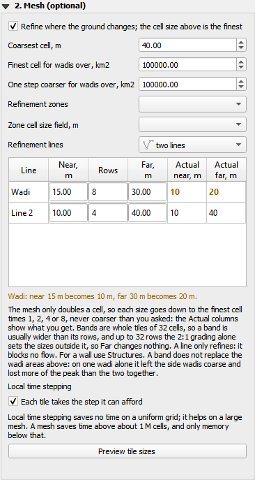
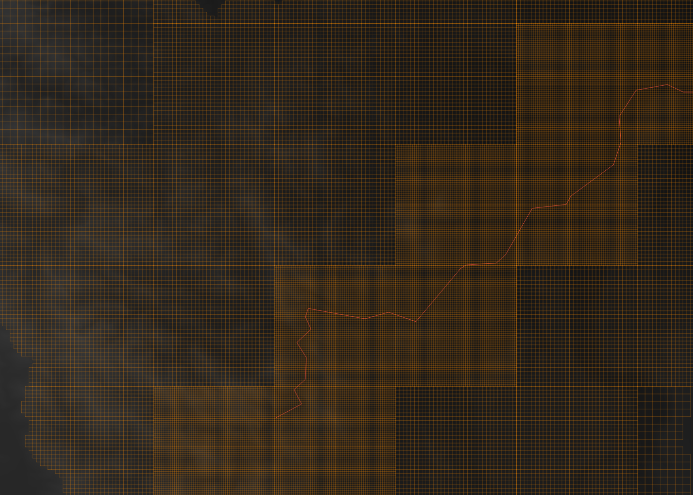

# W23 mesh controls

```
[PRESERVE-CHECK] D3, mesh controls. Written before any edit, on 4ec2ac2.

KEEP (not touched, same numbers)
- The uniform path: grid, tables, cache key, solver, every output.
- A mesh job with no lines: same levels, same grid, same numbers, same job.json from the dock (no `lines` key).
- Stream rules, slope breaks, zones, refine_lines, lines_on_coarse_tiles, balance, QuadGrid, the refusals of mesh_grid.
- The mesh stays off by default. Section 2 keeps every widget it has, the preview, local time stepping.
- mesh_text for a preview with no lines, mesh.json's existing keys, the `mesh` event.

CHANGE
- schema.py: new RefineLine (name, coordinates, near_dx, rows, far_dx); new Mesh.lines, default []. Adds; removes nothing.
  The frozen tests/plugin/schema_sample.json is regenerated to match.
- refine.py: new rung() (a size to the ladder, down), new band_levels(). zone_levels calls rung() in place of its own
  identical expression: no change of behaviour, one rule for "a size on the ladder".
- build.py: lattice_levels also takes band_levels; new line_sizes() (asked and actual, per line); MeshReport gains `lines`;
  report() takes them; build_grid refuses a line that reaches no active cell.
- cli.py: `wadi2d mesh` passes the line sizes to the report.
- run.py: a run with rounded line sizes warns once per line.
- plugin job_builder.py: new notes, problems and job keys for lines, `mesh_lines.geojson` in inputs/.
- plugin protocol.py: mesh_text adds the lines when there are any.
- plugin sections/mesh.py: a line layer, a table of near, rows, far with actual near and far beside them, a note.
- plugin dock.py: passes the finest cell to the section, which never reads another section.
- New: plugin mesh_rows.py (rows, no Qt), plugin sections/mesh_lines.py (the table), tests, this folder.

FILES
wadi2d/config/schema.py, wadi2d/mesh/refine.py, wadi2d/mesh/build.py, wadi2d/engine/cli.py, wadi2d/run.py,
plugin/wadi2d_qgis/{job_builder,protocol,dock,mesh_rows,README}, plugin/wadi2d_qgis/sections/{mesh,mesh_lines},
tests/engine/test_mesh_lines.py, tests/plugin/{test_mesh_rows,test_job_builder,test_contract,test_protocol}.py,
tests/plugin/schema_sample.json.

AMENDED during the work, nothing removed
- dock.py also hands the map canvas to the Mesh section, so a row can flash its line, as the Boundaries table does.
- tests/plugin/test_contract.py: one existing import put in the order ruff wants; it failed ruff on 4ec2ac2 too. Own commit.
```

**Status (2026-11-02): done, D3 of his work order, on `feature/mesh-controls`, not merged.** Section 2, Mesh, has a table of
refinement lines as in HEC-RAS: near cell, rows, far cell, with the actual near and far beside them. Off by default with the mesh;
existing jobs and the uniform path give their numbers unchanged, shown below on six cases.

**What to read first.**
1. **A band on the main wadi alone does not hold the peak.** On Bidah, 8 rows of 10 m on a 5.8 km main stem, streams off, read
   **6.8 % low at the dam axis and 7.8 % low at a wadi section**, 2 min late: it fails the 5 % rule fixed before the run. With
   the stream rules on as well it passes, **4.1 % low at worst**, at 2.3 x fewer cells than uniform 10 m. A band over the whole
   domain comes back to the fine run within 0.05 %, so the band is built right; the loss is the side wadis and slopes left coarse,
   as W3 section 8 found (that 18 % is in W3, not W5 as the brief has it). The dock says so.
2. **Far changes nothing until a band passes about 32 rows.** A tile is 32 cells and the 2:1 balance already grades through
   every size, one ring of tiles each. Measured on a straight line and on the real stem, six positions each: identical meshes up
   to 32 rows, different at 64. The column is kept, as the work order asks, and the dock says this in words.
3. **A band is whole tiles**: 8 rows (80 m) came out about 640 to 960 m wide. Never narrower than asked, usually much wider.

## How it works

A line asks for a near size, a number of rows and a far size. Each size goes **down** the ladder, `grid.dx` times 1, 2, 4 ...
up to the coarsest cell, never coarser than asked; above the coarsest it holds there, below the finest it holds there. The
line marks every lattice square within `rows x near` of it at the near level, then for each doubling up to far as many rows
again, so the band reaches `rows x (2 far - near)`. Past that the line has no say: the other rules and the 2:1 balance take
over. A line only refines. It is no wall and puts no faces on itself; barriers stay in Structures.

- **Engine** (`wadi2d/mesh/refine.py` `rung`, `band_levels`; `build.py` `line_sizes`): `mesh.lines` in the job, default empty.
  `wadi2d mesh` writes asked and actual per line into `mesh.json`; a run warns once per line whose sizes moved; a line that
  touches no active cell is refused in plain words, exit 2, because it would refine nothing and say nothing.
- **Dock**: a line layer, then the table. **Actual near and Actual far are worked out at every key press**, before any engine
  call; a size that moved is bold amber, with a sentence under the table, and again in the message when Run is pressed. The
  ladder starts at the snapped cell size (12 m on 5 m pixels is 10 m). Rows start at the finest and coarsest cells and follow
  them until set by hand or by a field. Fields `near_dx`, `rows`, `far_dx` (and `name`) fill a row, which is the door for D4:
  Suggest breaklines only has to hand the section a layer (`MeshSection.lines.layer.setLayer`), and its button goes in the
  section's form like any other row. **Preview tile sizes** gives the engine's own numbers per line.
- **One rule, two places.** The table does the ladder sum itself so it can answer at once; `test_the_table_s_ladder_is_the_engines`
  holds it to the engine's `rung` over seven ladders and seventeen sizes each, and the dock test checks table against `mesh.json`.





The cell grid layer from the real run, drawn off the screen and looked at: 10 m tiles follow the line as a staircase, 20 m beside
them, 40 m beyond (the darkest squares). Streams were off, so every fine tile there is the band's.

## Results

### Real dock, `dock_mesh_controls.py`: 67 of 67

QGIS 3.44.8, throwaway profile, Bidah ground (`h.Bidah()`), `log_dock_mesh_controls.txt`. The plugin and the engine are this
worktree's: the harness checks the plugin's path, a subprocess prints the engine's `wadi2d.__file__` through `engine.py`, and the
engine that answered knows `mesh.lines`, which `main` does not. Covered: table off with the mesh; one row per line, names from
the layer or numbered; defaults from the two ends and the schema; sizes off the ladder shown and said; keys typed into a box
keep their text and Actual answers at once; follows the finest cell, snapped, and the coarsest; near above far refused before a
run; preview names each line and equals the table; a run on the band: job, `inputs/mesh_lines.geojson`, resolved config, the
run's warning, mass, cells of the cell grid layer equal to the solver's, every tile on and within 8 rows of the line at 10 m,
none under 10 m more than 2 km away; a mesh with no lines writes no `lines`; fields fill a row; an edit of the layer keeps a set
row; a layer leaving the project; a line off the domain refused by name; the mesh off gives the uniform job.

**The dock found one fault the unit tests did not**: a line with an empty `name` field showed as "NULL". QGIS's NULL is not
Python's None. Fixed in the table. The Boundaries table has the same `line_label` and would show "NULL" the same way; not touched
here, it is another section.

Also rerun on this branch through the real dock: W17 cell grid 21 of 21, W18 boundary table 34 of 34.

### Existing jobs to the last digit, `same_numbers.py`, `same_numbers.txt`

The frozen Bidah job, run on `4ec2ac2` (unpacked from git) and on this branch, each process checking which `wadi2d` it loaded.

| Case | Files | Result |
|---|---|---|
| uniform 10 m, GPU, 30 h | 17 | identical |
| uniform 20 m, CPU, 2 h | 17 | identical |
| mesh 10 to 40 m, GPU, 30 h | 19 | identical |
| same, local time stepping | 19 | identical |
| mesh, CPU, 2 h | 19 | identical |
| mesh with a zone, streams off, GPU, 2 h | 19 | identical |

Every series CSV, every map raster as read, every dataset of `results.h5`, every row of `map_layers.gpkg`, the mesh preview raster
and `mesh.json` less its new `lines` key, cells, steps, smallest step, peaks, outflow and storage. `config.resolved.json` is equal
with the new empty `mesh.lines` taken out. **One number moves: the rain total in the balance, by at most 5.3e-16.** It is not this
work: the base engine run twice moves it as much (GPU 3,576,148.6642430592 against ...574, CPU 1,324,788.014728547 against
...5468); it is a threaded sum. The first try of the short cases had no rain at all, the job's own storm is dry for its first
hours, so it proved nothing; they now run a 60 mm hour from the start.

### Band against fully fine, `band_vs_fine.py`, `band_vs_fine.json`

The frozen Bidah rain-on-grid job (W1, n 0.05, 10 m, 30 h, GPU), peaks against uniform 10 m. Rule fixed before the first run:
every line within 5 %. `axis` and `s13_edge` are the job's long lines; `wadi_25/50/75` are 240 m sections across the main wadi
alone at those shares of the stem from the outlet, because a long line flatters a mesh (W3). The stem (`wadi_line.geojson`)
is traced from the DEM by drainage area, 5.8 km. Mesh cases: coarsest 40 m, local time stepping on, as the dock sets it.

| Case | Cells | axis | s13_edge | wadi_25 | wadi_50 | wadi_75 | Rule |
|---|---|---|---|---|---|---|---|
| Uniform 10 m | 220,006 | 621.9 | 633.7 | 439.4 | 227.3 | 96.6 m3/s | |
| Band 8 rows, streams off | 89,550 | -6.79 % | -6.63 % | -7.76 % | -4.05 % | -1.38 % | fail |
| Band 40 rows, streams off | 110,976 | -4.72 % | -4.58 % | -4.83 % | -3.79 % | -1.42 % | pass |
| Band over everything, streams off | 220,006 | -0.01 % | -0.02 % | 0.00 % | -0.05 % | -0.02 % | pass, the control |
| No band, streams off | 60,979 | -9.89 % | -9.75 % | -10.56 % | -7.46 % | -3.28 % | fail |
| Stream rules only (W10's mesh) | 74,708 | -3.51 % | -3.42 % | -3.09 % | -5.06 % | -3.26 % | fail |
| **Stream rules and the 8-row band** | 96,829 | -3.29 % | -3.22 % | -3.14 % | -4.10 % | -1.36 % | **pass** |

Peak time at the axis: 12.3 h fine; 2 min later with the 8-row band; 1 min later with rules and band (series every 60 s).

Read: every mesh reads low, never high; the coarse cells lose peak. The band buys back about a third of what a mesh with nothing
fine loses, but on the main stem alone it cannot hold 5 %. The stream rules alone reproduce W10 (-3.51 % against -3.54 %) and pass
on its long lines, yet **miss 5 % on a section across the wadi (-5.06 %)**: W10's gate was read on long lines only. The rules and
a band together pass everywhere. One catchment, one storm, one roughness: a reading, not a law [Likely].

### Unit tests, mutation checks, suite

`tests/engine/test_mesh_lines.py` (ladder, bands, rows, far, two lines, 2:1, zones as before, sizes and the report, a band
through the engine with mass, more cells, the run's warning, a line off the domain, the preview, lines ignored on the uniform
grid), `tests/plugin/test_mesh_rows.py`, and additions to `test_job_builder.py`, `test_contract.py`, `test_protocol.py`.

**Mutation checks** (`mutants.py`, on a scratch copy of the branch): 30 faults put into the new engine and dock code one at a
time. 29 were caught at once. The 30th, a far size moved while near was not, went unsaid by the engine; a test for it was added
and now catches it. A clean first pass is what W10 warned proves nothing.

**Full suite on the final code** (`1ba58c6`): 1,249 passed, none skipped or failed, exit 0. Ruff clean on everything; `tests/plugin/test_contract.py` had one import out of order on `4ec2ac2` too,
fixed in its own commit.

## Not tested

- The CPU backend through the dock; the dock's runs are on the GPU. The CPU mesh path is in the same-numbers table and the unit tests.
- A band on a second catchment, another storm, or a coarsest cell other than 40 m. The 5 % reading is Bidah's.
- Any run time: the card was shared with other work throughout, so no timing is quoted.
- Two lines crossing or close together through the dock (unit-tested only); a multi-part line feature (each part is sent with the
  same row; not run).
- The W3 synthetic valley with a band, where the 18 % was found. Bidah is real ground and was used instead.
- Persisting the table: values set by hand last for the session, as in the Boundaries table; fields in the layer are the way to
  keep them.

## Files

`dock_mesh_controls.py` the dock check, `log_dock_mesh_controls.txt` its record. `band_vs_fine.py`, `band_vs_fine.json`,
`wadi_line.geojson` the comparison. `same_numbers.py`, `same_numbers.txt` existing jobs on both trees. `far_sweep.py` when Far
changes the mesh. `mutants.py` faults put in one at a time. Pictures: `mesh_section.png`, `band_on_cell_grid.png`. Run folders were
in the session's scratchpad and are not kept.

```
powershell -File tests\dock\run_check.ps1 "W23 mesh controls\dock_mesh_controls.py" <throwaway folder> -Copy "W23 mesh controls"
```
